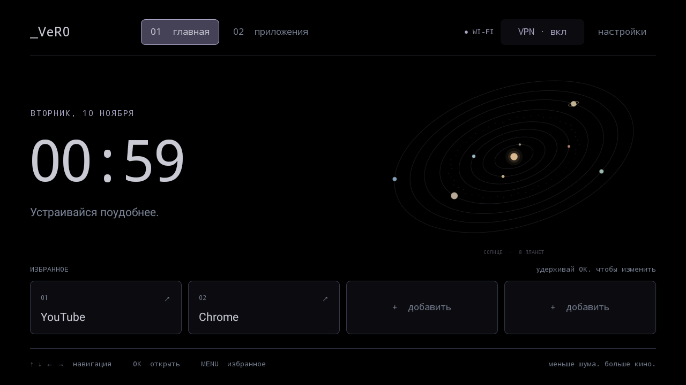

# focal-launcher

Минималистичный домашний экран для Android-проектора: часы, солнечная система, избранное, темы лаванда/OLED, веб-пульт телефона и кнопка VPN.



**0.5.3 · Android 11 · ARM32 · D-pad.** Пакет `dev.projector.rice` и подпись сохранены для обновлений прежнего Rice; `_VeR0` — подпись в интерфейсе.

## Быстрый старт

Из корня репозитория:

```sh
python3 scripts/workflow.py check
python3 scripts/workflow.py build --no-system-install
```

Первая команда проверяет проект офлайн. Вторая проверяет исходники и ключ, скачивает закреплённый Android SDK с проверкой SHA-256 и собирает `dist/focal-launcher-0.5.3.apk`. Обе работают без проектора.

| Задача | Что установить |
| --- | --- |
| Проверки | Python 3.9+, Git, Node.js 24+ |
| Сборка APK | Всё выше + JDK 21; SDK Platform 30 / Build Tools 35.0.0 загружает сборщик |
| Обновление проектора | Всё выше + ADB, PRIVATE update kit и доступ к проектору в локальной сети |

Официальные инструменты: [Python](https://www.python.org/downloads/), [Node.js](https://nodejs.org/en/download), [JDK 21](https://adoptium.net/temurin/releases/?version=21), [Android Platform Tools / ADB](https://developer.android.com/tools/releases/platform-tools). Make и Android Studio необязательны, Gradle не используется.

- **Linux x86_64:** установите зависимости и используйте команды выше. На Arch `./focal build` и `./focal update` также предлагают установить недостающие пакеты через pacman; `--no-system-install` отключает это.
- **macOS:** те же Python-команды, JDK 21 и совместимые с процессором инструменты SDK для macOS. При необходимости задайте `--java-home /path/to/jdk-21`. Сборщик выбирает архив SDK для macOS.
- **Windows x86_64:** используйте [WSL 2](https://learn.microsoft.com/windows/wsl/install), храните проект в `~/Projects/` внутри WSL и выполняйте команды в её терминале. Для установки нужен доступный из WSL ADB. Нативная сборка в PowerShell и Linux ARM64 пока не поддерживаются.

## Обновить свой проектор

Для совместимого обновления установленного приложения нужен отдельный **PRIVATE update kit**. Для чтения исходников и GitHub он не нужен.

1. Распакуйте kit в корень `focal-launcher`: появятся `local/device.json` и `local/signing/rice-development.jks`. Они исключены из Git; сохраните резервную копию kit отдельно.
2. Проверьте `adb_serial` в `local/device.json`: это текущий адрес ADB. Если IP изменился, меняйте только адрес. Значения `expected` — заранее проверенная идентичность вашего проектора; не подстраивайте их под случайное подключённое устройство. Публичный шаблон `config/device.example.json` намеренно не проходит проверку.
3. При включённом проекторе, доступном ADB и компьютере в той же сети запустите:

```sh
python3 scripts/workflow.py update --no-system-install
```

Команда собирает APK, проверяет хеш и оригинальный сертификат, затем идентичность проектора, штатные `sh`/`qw` и уже работающую factory-службу. Установка — обычный `adb install -r` с сохранением темы, избранного и данных. Вспомогательный файл веб-ввода в `/data/local/tmp` проверяется отдельно. Прошивка и перезагрузка не нужны.

Сборку и установку можно разделить:

```sh
python3 scripts/workflow.py build --no-system-install
python3 launcher/install.py
```

Полезные параметры: `--java-home /path/to/jdk-21`, `--sdk /path/to/android-sdk`, `--adb /path/to/adb`, `--device-config /path/to/device.json`. Параметр `update --serial ADDRESS:PORT` меняет только адрес, сохраняя проверку физической идентичности. Смотрите `--help` соответствующей команды.

Установщик не меняет HOME по умолчанию: при необходимости выберите focal-launcher в настройках Android. Штатная оболочка остаётся доступна из настроек лаунчера. При ошибке подписи нужен оригинальный ключ; не удаляйте приложение и не очищайте данные ради обхода ошибки.

Без kit доступна отдельная тестовая сборка: `python3 scripts/workflow.py build --no-system-install --test-key`. Она **не подходит для обновления вашего проектора** или работы с уже установленным VPN companion.

## Управление

- Стрелки и OK — навигация; MENU или долгое OK — изменить четыре места избранного.
- Настройки → Тема — лаванда или OLED. Здесь же штатные настройки проекции и оригинальный HOME.
- YouTube — ярлык установленного TizenTube Cobalt. Его APK, аккаунт и данные не меняются; Chrome и остальные приложения обнаруживаются автоматически.
- Настройки → Веб-пульт — адрес `http://IP-ПРОЕКТОРА:8080/` и PIN. Откройте адрес на телефоне в той же сети и подключитесь. Компьютер после установки не нужен.
- «Новый код» отключает прежние браузеры; «Выключить» останавливает пульт. Подключение хранится семь дней, тема пульта — отдельно от темы лаунчера.
- Клавиатура передаёт до 256 печатных ASCII-символов. Кириллица пока не поддерживается, у TizenTube есть особенности регистра и знаков с Shift. После обновления APK обновите страницу телефона.

## Экран MacBook на проекторе

На устройстве владельца уже установлен **ApowerMirror for TV 1.1.5**. Для подключения:

1. На проекторе откройте **Приложения → ApowerMirror** и оставьте приложение запущенным.
2. Подключите MacBook и проектор к одной локальной Wi-Fi-сети.
3. На Mac откройте **Пункт управления → Повтор экрана → Apowersoft[Projector]**. Если появится запрос кода, следуйте подсказке на экране проектора. [Инструкция Apple](https://support.apple.com/guide/imac/stream-content-on-a-larger-screen-apdf1417128d/2025/mac/26).
4. Чтобы закончить трансляцию, отключите приёмник в меню «Повтор экрана» на Mac.

В ApowerMirror → Settings → AirPlay resolution выбрано **720P**. Обнаружение через `_airplay._tcp` проверено; владелец подтвердил передачу изображения и звука с MacBook. Имя приёмника зависит от TV name в ApowerMirror. Приложение и лицензия принадлежат Apowersoft, его APK не входит в этот репозиторий.

Для текущей трансляции подтверждены прямые локальные соединения Mac → проектор на портах 36666 и 46000. Однако у процесса ApowerMirror наблюдались и внешние HTTPS-соединения; их назначение и содержимое не установлены. [Политика Apowersoft](https://www.apowersoft.com/privacy) допускает сбор технических данных и аналитику. Локальный маршрут AirPlay не означает полной изоляции приложения от интернета.

## VPN — необязательно

Короткое OK на VPN переключает соединение, долгое открывает клиент. Нужен companion из `singbox-integration/`, подписанный тем же ключом. Обычный SFA не предоставляет этот интерфейс. Уже установленный VPN для обновления лаунчера пересобирать не нужно.

Для пересборки нужны собственный `local/vpn.json` по шаблону `config/vpn.example.json` и оригинальный `SFA-1.14.4-armeabi-v7a.apk` из [релиза SagerNet](https://github.com/SagerNet/sing-box/releases/tag/v1.14.4). URL и профиль остаются приватными.

```sh
python3 singbox-integration/build.py --help
```

При наличии Make: `make vpn SFA_APK=/path/to/SFA-1.14.4-armeabi-v7a.apk`. Пути SDK/JDK задаются параметрами Make или в игнорируемом `local/build.mk`. Результат — `dist/focal-vpn-1.14.4.apk`. Сборщик проверяет исходный APK, общую подпись и неизменность native-библиотек; на устройство ничего не устанавливает.

Клиент загружает конфигурацию по HTTPS, при недоступности URL использует последнюю сохранённую, отклоняет некорректную новую. Локальные сети и ADB исключены из TUN. Профиль хранится внутри клиента. Сам VPN и HOME не требуют root; веб-ввод зависит от уже работающей заводской `qw`.

## Проектор

Данные исходного исследования 9–10 ноября 2026 года:

| Параметр | Значение |
| --- | --- |
| OEM | `P30_H713_V1.1_CHIHI_emcp` |
| Платформа | Allwinner H713M, `sun50iw12p1` / `ares` |
| Система | Android 11 / API 30, Linux 5.4.99, `armeabi-v7a` |
| Память | Linux видит около 1,41 ГиБ RAM; eMMC 7 818 182 656 байт (класс 8 ГБ) |
| Интерфейс | 1280 × 720, 160 dpi; физическое разрешение матрицы отдельно не проверено |
| Прошивка | `H713M-android11-v1.0`, `202410161629`, `OB.283` |


Фото из [каталога Techno Shop](https://technoshop.pk/product/p30-mini-4k-android-portable-projector/): P30 с H713. **Совпадение корпуса и ревизии с устройством владельца не подтверждено.** Это внешний пример; права на фото остаются у правообладателя, файл не включён в исходники. Торговое название P30 предполагается; инструменты проверяют OEM-свойства.

Известные ограничения: надёжный автозапуск после включения не исправлен — владелец видел штатный HOME после настоящего перезапуска. Регулятор физической яркости не реализован. Совместимость с другими Android-устройствами отдельно не проверена.

## Разработка

| Путь | Назначение |
| --- | --- |
| `launcher/src/dev/projector/rice/` | `MainActivity` — HOME/избранное; `Palette`/`SolarSystemView` — вид; `VpnController` — VPN |
| `Remote*.java`, `InputRelay.java` в том же каталоге | Пульт, подключение, очередь и обработчик ввода |
| `launcher/assets/remote/` | HTML/CSS/JS телефона, включаемые в APK |
| `launcher/build.py`, `launcher/install.py` | Сборка и проверенная установка |
| `scripts/` | Workflow, SDK, device guard и офлайн-тесты |
| `singbox-integration/` | Companion, исходники и лицензии upstream |
| `config/`, `docs/images/` | Публичные шаблоны и снимок интерфейса |

Перед коммитом: `python3 scripts/workflow.py check` (или `make check`). Это офлайн-проверки без ADB, сети и SDK. `launcher/qa/check_remote_http.py` и `singbox-integration/qa/` — отдельные ручные проверки на устройстве, не часть этой команды.

При изменении приложения увеличьте `versionCode` и `versionName` в `launcher/AndroidManifest.xml` и обновите этот README. Изменения только документации/инструментов новой версии APK не требуют. Сохраняйте package ID, `rice` SharedPreferences, alias ключа, signature permission и VPN RPC: от них зависят обновления и данные.

HTTP работает под UID приложения: сохраняйте PIN/хеши токенов, Host/Origin, CSP, ограничения LAN, запросов и очереди. `InputRelay` работает как UID/GID 2000 с CapEff=0, использует частный Unix-канал и завершается с приложением. Не добавляйте сетевой shell, произвольные Activity или исполняемые загрузки. Не логируйте текст, PIN, токены и VPN-конфигурацию.

**Независимое аварийное восстановление не подтверждено.** Не меняйте прошивку, AVB, слоты и USB, не перезагружайте устройство и не запускайте root daemon в рамках разработки лаунчера. Исследование загрузки — отдельный [projector-root](https://github.com/ver0lol/projector-root).

<details>
<summary>Точные ограничения для инструментов и ИИ-агентов</summary>

Target family: P30_H713_V1.1_CHIHI_emcp, Android 11 / API 30, sun50iw12p1 / ares, armeabi-v7a, original slot `_a`. The exact identity and ADB address are pinned in ignored `local/device.json`. Device tools must reject missing/template configuration and identity mismatches before staging or installing anything. Never learn an expected identity automatically from whichever ADB device happens to be connected.

DO NOT write raw block devices, flash, erase, unlock, change AVB/boot-control state, switch slots, reboot, enter fastboot/FEL/recovery, install root, or start/restart a root daemon until BOTH an independent safe recovery route has been demonstrated and the owner explicitly approves the exact action. A generic request to continue does not authorize these operations. Independent recovery remains unverified. Slot B contains zero-filled images; A/B names do not prove recovery.

Never read the Allwinner `sysfs usb_device` / `usb_host` trigger nodes or change `persist.sys.usb0device`: reads of those special nodes can change USB roles. Do not guess hardware PWM limits or change fan controls while implementing brightness UI.

Keep original images immutable. Block reads use the parent eMMC node, pinned geometry, bounds, GPT CRC and exact lengths/hashes. `adb exec-out` merges remote stderr; redirect `dd` stderr away from binary data. No automated preparation script may contain a flash/write command.

Existing factory `qw --daemon` root has been verified without flashing. The separate projector-root repository supplies the root diagnostics script; this repository only bootstraps the app input helper through that ALREADY RUNNING daemon. It verifies identity, hashes, socket and staging permissions. Never add a daemon-start, remount, property-change or weakened-check fallback. Root availability is not permission to reboot/flash/alter USB.


Публикация не требует подключения к проектору. Не используйте `git add -f` для приватных файлов или `git clean -fdx` / `git clean -X`: игнорируемые каталоги содержат реальные настройки и ключи. Отличайте наблюдения от гипотез. Актуальные правила и состояние описаны в этом README.

</details>

## Git и сторонние авторы

Автор и коммитер локальной истории — **Vlad Remizov**; имя/email настроены только в этом репозитории. Следующие изменения: `git add`, `git commit`, `git push`. Опубликованную историю не переписывайте.

`local/`, `work/`, `dist/`, APK, SDK, ключи, VPN-профили, резервные образы и исходные ZIP исключены из Git. Исходники и скриншот публичны; вся документация находится здесь.

Проект владельца создавался с помощью ИИ и друга. Авторство сторонних компонентов сохраняется:

- **SagerNet/sing-box, SFA:** [релиз 1.14.4](https://github.com/SagerNet/sing-box/releases/tag/v1.14.4). Focal VPN — локально изменённая сборка, не официальный продукт SagerNet. Добавленный код companion — GPL-3.0-or-later; сохранены [COPYING](singbox-integration/COPYING), [уведомление upstream](singbox-integration/UPSTREAM-LICENSE.txt), [происхождение/хеши](singbox-integration/source-provenance.json).
- **Исходники upstream:** `singbox-integration/upstream/` содержит source archives, не APK или конфиги. SFA commit `f87c2ebdb7e34754be751bb5e58926db2fed8f8c`; `SHA256SUMS` проверяется офлайн. Эти архивы сохранены вместе с лицензиями. SHA-256 исходного APK: `b1ae76164e1f518c0ae343ce30d8ee63fbb46a59f1e12295bf5bd20f1e1a5e1b`.
- **Android/AOSP SDK:** официальные инструменты Google; URL и SHA-256 закреплены в `scripts/toolchain.py`, SDK не включён в репозиторий.
- **TizenTube Cobalt:** [проект reisxd](https://github.com/reisxd/TizenTubeCobalt); его код/APK сюда не включены, лаунчер лишь даёт ярлыку имя YouTube.
