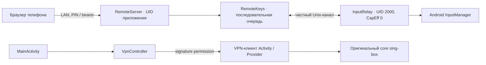

# Архитектура

При запуске RemoteKeys проверяет платформу, хеши shell/qw, готовый factory socket и права staging-файла. Существующий qw кратко запускает shell-UID InputRelay и завершает запрос. Relay не слушает IP, проверяет владельца канала и выходит при закрытии канала/завершении focal-launcher. Не заменяйте эту схему постоянной root-службой.

## Карта исходников

| Файл в `launcher/src/dev/projector/rice/` | Ответственность |
| --- | --- |
| `MainActivity.java` | HOME, обнаружение приложений, сортировка, избранное, alias YouTube, навигация |
| `Palette.java`, `SolarSystemView.java` | Палитры, сохранение темы, отрисовка солнечной системы |
| `VpnController.java` | Состояние/переключение VPN, UI переходного состояния |
| `RemoteService.java`, `RemoteBootReceiver.java` | Foreground HTTP-служба, обновление пакета, boot callback |
| `BootHome.java` | Однократный переход к выбранному HOME на новую загрузку |
| `RemoteAccess.java`, `RemoteSettings.java` | PIN, хеши сессий, сеть/адрес, настройки пульта |
| `RemoteServer.java` | Фиксированные assets и ограниченный JSON API, Host/Origin/auth |
| `RemoteKeys.java`, `InputRelay.java` | Проверенный запуск обработчика и сериализация ввода |
| `RemoteKeyCodes.java`, `RemoteText.java` | Общий allowlist кнопок и ограничения текста |

Веб-файлы: `launcher/assets/remote/index.html`, `remote.css`, `remote.js`. Они включаются в APK при сборке и загружаются сервером из assets. Редактирование на Mac не меняет установленный APK.

## Состояние

- Android `rice`: `pins`, `pinsSet`, тема/OLED, акцент, однократная миграция alias YouTube.
- Android `web-remote`: PIN и хеши сессий, разрешение запуска пульта. Не включать в журнал или репозиторий.
- Android `boot-home`: идентификатор уже обработанной загрузки; не сбрасывать при обычном обновлении.
- Браузер: `ver0-remote-session`, `ver0-remote-theme`. Страница не хранит набранный текст постоянно.
- VPN: профиль и конфигурация в закрытом каталоге SFA; build-time endpoint приходит из игнорируемого `local/vpn.json`.

## Контракты HTTP

`GET /`, `/remote.css`, `/remote.js` — фиксированные assets. `POST /api/pair` — PIN и ограничение попыток. Авторизованные `/api/status`, `/api/key`, `/api/text`, `/api/logout` используют bearer. POST требует правильный Origin; Host должен совпадать с адресом проектора. Текст не является shell-командой; IPC получает Base64 и генерирует аппаратные KeyEvent.

## Рецепты расширения

Новая кнопка пульта: добавить фиксированное имя/код в RemoteKeyCodes, кнопку в HTML, при необходимости обработчик JS, проверить auth, очередь и отсутствие повтора после задержки. Не добавлять общий endpoint выполнения команд.

Новый элемент focal-launcher: отдельный контроллер/представление при существенной логике, TV-фокус и управление D-pad, сохранение существующего состояния. Избегать постоянных таймеров/перерисовок на слабом устройстве.

Изменение VPN: код overlay в `singbox-integration/src/`, манифест через `axml_bridge.py`. Kotlin ABI закреплён по конкретному исходному APK; при обновлении upstream проверять ABI, а не убирать проверки. Native-библиотеки должны оставаться побайтно равными upstream.

Изменение схемы настроек: однократная миграция с сохранением порядка/предпочтений. Alias TizenTube намеренно находится только в focal-launcher: переподпись стороннего APK разрушит совместимость обновлений и может затронуть аккаунт.

## Инструменты разработчика

`focal` запускает `scripts/workflow.py`: check работает офлайн, build готовит инструменты и APK, update дополнительно вызывает launcher/install.py. `scripts/toolchain.py` выбирает Linux/macOS SDK, проверяет SHA-256 и безопасную распаковку, находит JDK 21 и проверяет оригинальный сертификат. Приватный комплект находится только в игнорируемом local/. Firmware/root-репозиторий не является зависимостью.
